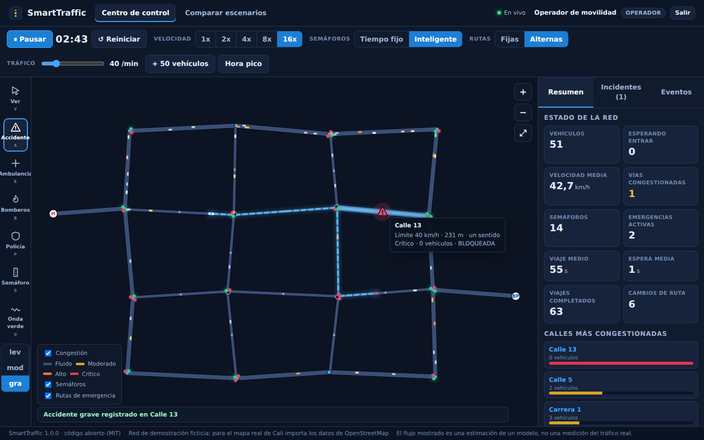
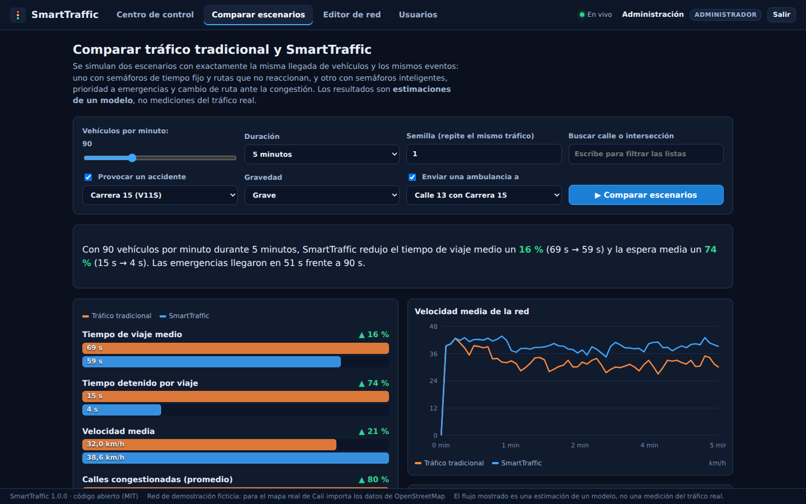
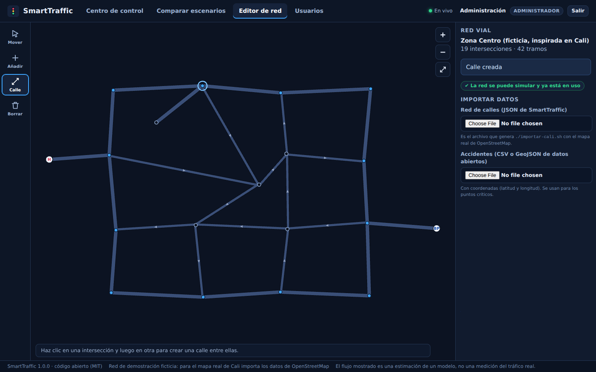

# SmartTraffic

[](https://github.com/jsaguadob/smarttraffic-cali/actions/workflows/ci.yml)


Centro de control de movilidad urbana **de código abierto**, hecho en **Java**, sobre el **mapa real de Cali
(OpenStreetMap)** y los **datos abiertos** de la ciudad. Proyecto académico de Estructuras de Datos.



> **Qué es y qué no es.** No controla semáforos ni lee sensores reales de la ciudad (eso no es posible para un
> proyecto académico). Los vehículos animados son una **estimación del flujo** que calcula un modelo sobre calles
> reales; los incidentes y las emergencias los registra el operador. Las comparaciones entre «tráfico tradicional» y
> «SmartTraffic» son resultados **del modelo**, no mediciones del tráfico real.

## Qué hace

- **Mapa interactivo**: calles con curvas y sentidos, vehículos en movimiento (autos, motos, buses), semáforos que cambian,
  congestión por colores, zoom y arrastre (también en el celular).
- **Se puede tocar**: provocar un accidente con un clic sobre una calle, despachar ambulancia, bomberos o policía a una
  intersección (con su ruta prioritaria dibujada), fijar un semáforo, sincronizar una «onda verde», agregar vehículos,
  cambiar entre semáforos de tiempo fijo e inteligentes.
- **Semáforos inteligentes**: puntuación de congestión `P = 0,7·V + 0,3·T`, tiempos de verde ajustados, nunca dos
  grupos que se cruzan a la vez, y paso preferente a emergencias.
- **Rutas**: Dijkstra y A\* con costos que cambian con el tráfico y los cierres; los conductores buscan otro camino.
- **Comparar escenarios** con exactamente la misma demanda y los mismos eventos, con gráficas e historial guardado.
- **Datos reales**: importador de OpenStreetMap (calles, sentidos, glorietas, semáforos, hospitales, bomberos, policía) y
  lector de datos abiertos de accidentalidad para el ranking de **puntos críticos**.
- **Tres roles**: administrador (red, datos y usuarios), operador de movilidad (simulación, incidentes, emergencias) y
  analista (consulta y comparación, solo lectura). Contraseñas con PBKDF2, sesiones JWT, límite de intentos, auditoría.

| Comparación de escenarios | Editor de red |
|---|---|
|  |  |

## Inicio rápido

Requisitos: **JDK 17 o superior** y, para compilar la pantalla, **Node 20 o superior**.

```bash
SMARTTRAFFIC_DEMO=1 ./run.sh        # http://localhost:8080  (usuarios de demostración, ver más abajo)
```

En modo demostración el ingreso ofrece entrar con un clic como administrador, operador o analista. Usa la red de
demostración (ficticia). **El modo demostración nunca debe usarse en un servidor público.**

### El mapa real de Cali

```bash
./importar-cali.sh                  # descarga las calles de OpenStreetMap (necesita internet)
SMARTTRAFFIC_RED=backend/data/red-cali.json ./run.sh
```

Los accidentes (CSV o GeoJSON de [datos.cali.gov.co](https://datos.cali.gov.co)) se suben desde
**Editor de red → Importar datos**. Revisa la licencia de cada conjunto de datos antes de publicarlo.

## Pruebas

```bash
./test.sh                           # 56 pruebas JUnit (estructuras, rutas, simulación, importador, API, seguridad)
cd frontend && npm ci && npm run build
```

Con PostgreSQL real: `SMARTTRAFFIC_TEST_DB_URL=jdbc:postgresql://localhost/st SMARTTRAFFIC_TEST_DB_USER=... SMARTTRAFFIC_TEST_DB_PASSWORD=... ./test.sh`.
Pruebas de navegador (Chromium real): ver [`frontend/e2e/README.md`](frontend/e2e/README.md).

## Estructuras de datos propias

Todas están en `backend/src/main/java/smarttraffic/estructuras`, se prueban contra la biblioteca estándar de Java y
tienen un uso real en el sistema.

| Estructura | Para qué se usa |
|---|---|
| Grafo dirigido (listas de adyacencia) | La red vial: nodos = intersecciones, aristas = vías |
| Cola FIFO | Los vehículos de cada vía, en orden de entrada; la fila de espera para entrar a la red |
| Cola de prioridad (montículo) | Dijkstra y A\*; despacho de emergencias (ambulancia → bomberos → policía) |
| Tabla hash | Búsqueda inmediata de vehículos, vías, intersecciones e incidentes por identificador |
| Árbol AVL | Historial ordenado de incidentes y ranking de vías y puntos críticos (los «N más…») |
| Lista enlazada | Historial de eventos y vehículos de emergencia de cada vía |

## Estructura del proyecto

```
backend/src/main/java/smarttraffic/
  estructuras/   las seis estructuras de datos
  red/           intersecciones, vías, red vial y la red de demostración
  ruta/          Dijkstra y A*
  sim/           motor de simulación, semáforos, incidentes, emergencias, comparador
  datos/         importador de OpenStreetMap, datos abiertos, puntos críticos, base de datos (JDBC)
  web/           servidor HTTP (API REST, transmisión en vivo), seguridad, roles
frontend/        pantalla en React + TypeScript (mapa en canvas)
docs/            capturas y guía de despliegue
```

## Ramas y despliegue

`main` es producción y `desarrollo` es la rama de pruebas. La pantalla se publica en Netlify y el servidor Java en un
servicio de contenedores o en un servidor propio: ver [`docs/despliegue.md`](docs/despliegue.md).

## Autores

Juan Sebastián Aguado, Valentina Sánchez y Angie Paulette Murillo.

## Licencia y datos

Código bajo licencia **MIT** (ver `LICENSE`). Componentes y datos de terceros en
[`THIRD_PARTY_NOTICES.md`](THIRD_PARTY_NOTICES.md). Mapa © colaboradores de OpenStreetMap (licencia ODbL).
